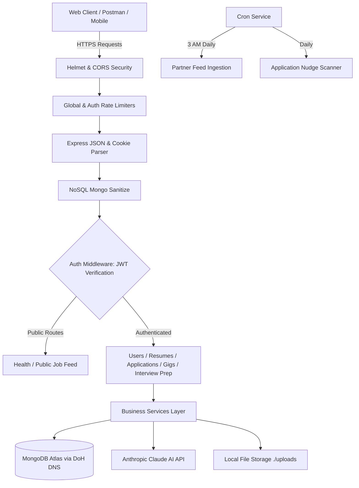
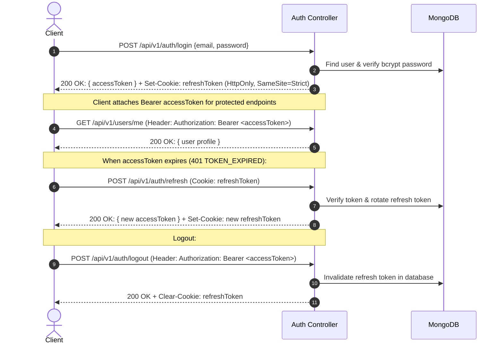
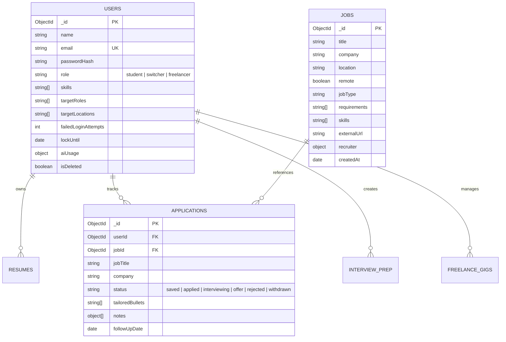

# JobWise Backend API & Architecture Documentation
> **Version:** 1.0.0  
> **Environment:** Development / Production  
> **Base URL:** `http://localhost:5001` (Default)  
> **API Prefix:** `/api/v1`  
> **Last Updated:** September 2026

---

## Table of Contents
1. [Architecture Overview & System Design](#1-architecture-overview--system-design)
2. [Environment Configuration](#2-environment-configuration)
3. [Security & Authentication Lifecycle](#3-security--authentication-lifecycle)
4. [Standard Response & Error Formats](#4-standard-response--error-formats)
5. [HTTP Status Codes & Scenarios Reference](#5-http-status-codes--scenarios-reference)
6. [Category-Wise Endpoint Catalog](#6-category-wise-endpoint-catalog)
   - [Health & Diagnostics](#61-health--diagnostics)
   - [Authentication Module](#62-authentication-module)
   - [User Profile Management](#63-user-profile-management)
   - [Resume Management & Parsing](#64-resume-management--parsing)
   - [Jobs & Match Feed](#65-jobs--match-feed)
   - [Application Tracker (Kanban)](#66-application-tracker-kanban)
   - [Skill Gap Analysis](#67-skill-gap-analysis)
   - [AI Interview Preparation](#68-ai-interview-preparation)
   - [Freelance Gigs Marketplace](#69-freelance-gigs-marketplace)
7. [Database Schema & Data Models](#7-database-schema--data-models)
8. [Critical Engineering Decisions & Solved Gotchas](#8-critical-engineering-decisions--solved-gotchas)
9. [Developer Handoff: Setup, Testing & Next Steps](#9-developer-handoff-setup-testing--next-steps)

---

## 1. Architecture Overview & System Design

JobWise is an AI-powered job search, resume tailoring, and career tracking platform. The backend is designed as a modular monolith built on **Node.js**, **Express 5**, and **TypeScript**, with **MongoDB Atlas** for document storage and **Anthropic Claude 3.5 Sonnet** for generative AI workflows.



### Core Architecture Highlights
- **Express 5 Native:** Utilizes modern asynchronous routing without requiring external wrapper libraries like `express-async-errors`.
- **DNS-over-HTTPS (DoH) Database Layer:** Solves the notorious Node.js c-ares DNS UDP packet truncation (`EBADRESP`) on Windows and dynamic ISP connections by resolving Atlas SRV records over HTTPS.
- **Strict Data Validation:** Every incoming payload (`req.body`, `req.query`, `req.params`) is strictly validated using **Zod schemas** before reaching controller logic.
- **Dual-Token Authentication:** 15-minute short-lived stateless JWT access tokens paired with 7-day stateful, cryptographically secure `HttpOnly` refresh tokens.

---

## 2. Environment Configuration

All environment variables are parsed and validated on boot via [`src/config/env.ts`](file:///c:/Users/devsh/OneDrive/Desktop/JobWise/backend/src/config/env.ts) using Zod. Missing required variables will halt bootstrap immediately with descriptive errors.

| Variable | Type | Default | Description |
|---|---|---|---|
| `NODE_ENV` | `string` | `development` | Runtime environment (`development`, `test`, `production`) |
| `PORT` | `number` | `5001` | TCP port Express server listens on |
| `MONGODB_URI` | `string` | Required | MongoDB connection string (`mongodb+srv://...` or standard URI) |
| `JWT_ACCESS_SECRET` | `string` | Required | 256-bit secret used to sign access tokens |
| `JWT_REFRESH_SECRET` | `string` | Required | 256-bit secret used to sign refresh tokens |
| `JWT_ACCESS_EXPIRES_IN` | `string` | `15m` | Lifetime of access tokens |
| `JWT_REFRESH_EXPIRES_IN` | `string` | `7d` | Lifetime of refresh tokens |
| `CLIENT_URL` | `string` | `http://localhost:5173` | Primary frontend web application URL |
| `CORS_ORIGINS` | `string` | Comma-delimited | Allowed CORS origins (e.g. `http://localhost:5173,http://localhost:3000`) |
| `ENCRYPTION_KEY` | `string` | Required | 32-byte hex string for AES-256-GCM token & PII encryption |
| `ANTHROPIC_API_KEY` | `string` | Optional | API key for Anthropic Claude AI (mock fallback enabled if omitted) |
| `AI_MODEL_DEFAULT` | `string` | `claude-3-5-sonnet-20241022` | Default AI model used for resume tailoring and Q&A |
| `AI_MONTHLY_TOKEN_BUDGET_PER_USER` | `number` | `200000` | Max AI tokens allocated per user per month |
| `STORAGE_DRIVER` | `string` | `local` | Storage driver (`local` or `s3`) |
| `UPLOAD_DIR` | `string` | `./uploads` | Directory for uploaded resume PDF/DOCX files |
| `JOB_FEED_POLL_CRON` | `string` | `0 3 * * *` | Cron schedule for partner job feed scraping |

---

## 3. Security & Authentication Lifecycle



### Rate Limiting Policies
- **Global API Limiter:** `120 requests / minute` per IP across all `/api/*` routes.
- **Strict Auth Limiter:** `10 requests / minute` per IP on `/api/v1/auth/*` (successful logins bypass counter to avoid locking out genuine users).

---

## 4. Standard Response & Error Formats

### 1. Success Envelope
All successful API responses return `status: 200` or `status: 201` with this JSON contract:
```json
{
  "success": true,
  "data": { ... }
}
```
*Optional `pagination` metadata is included for list endpoints:*
```json
{
  "success": true,
  "data": [ ... ],
  "pagination": {
    "total": 45,
    "page": 1,
    "limit": 20,
    "totalPages": 3
  }
}
```

### 2. Error Envelope
All error responses adhere to this structure:
```json
{
  "success": false,
  "error": {
    "code": "VALIDATION_ERROR",
    "message": "Validation failed",
    "fields": {
      "email": ["Invalid email address"],
      "password": ["Password must contain at least one uppercase letter"]
    }
  }
}
```

---

## 5. HTTP Status Codes & Scenarios Reference

| Code | Status | Meaning | Typical Trigger Scenarios |
|---|---|---|---|
| **`200`** | **OK** | Request succeeded | `GET` queries, `PATCH` status updates, user login, answer evaluation |
| **`201`** | **Created** | Resource created | `POST /register`, `POST /applications`, `POST /jobs`, `POST /interview-prep/generate` |
| **`400`** | **Bad Request** | Malformed request or validation failed | Missing required body fields, invalid regex (password), invalid enum values, malformed JSON body |
| **`401`** | **Unauthorized** | Missing or invalid auth | No `Authorization` header, expired access token, invalid JWT signature |
| **`403`** | **Forbidden** | Permission or ownership check failed | User attempting to update or delete another user's application, resume, or gig |
| **`404`** | **Not Found** | Resource does not exist | Invalid Job ID, non-existent Application ID, deleted Resume ID, unknown route |
| **`409`** | **Conflict** | Resource conflict | Email already registered (`E11000` duplicate key in MongoDB) |
| **`429`** | **Too Many Requests** | Rate limit tripped | Exceeded 10 failed logins/min or 120 API requests/min |
| **`500`** | **Internal Server Error** | Unexpected exception | AI provider failure, unhandled runtime exception |
| **`503`** | **Service Unavailable** | Infrastructure degraded | Database connection down during readiness probe (`/ready`) |

---

## 6. Category-Wise Endpoint Catalog

### 6.1. Health & Diagnostics

#### `GET /health`
- **Auth:** None (Public)
- **Description:** Verifies server process uptime and liveliness.
- **Success (200 OK):**
  ```json
  { "status": "ok", "uptime": 142.5 }
  ```

#### `GET /ready`
- **Auth:** None (Public)
- **Description:** Verifies MongoDB connection state (`readyState === 1`).
- **Scenarios:**
  - **Database Connected (200 OK):**
    ```json
    { "status": "ready", "database": "connected" }
    ```
  - **Database Degraded / Disconnected (503 Service Unavailable):**
    ```json
    { "status": "degraded", "database": "disconnected" }
    ```

---

### 6.2. Authentication Module

#### `POST /api/v1/auth/register`
- **Auth:** None (Public, Rate Limited)
- **Body:**
  ```json
  {
    "name": "Dev Sharma",
    "email": "dev@example.com",
    "password": "Password123",
    "role": "student"
  }
  ```
- **Field Constraints:**
  - `name`: Min 2, max 100 characters.
  - `email`: Valid email format (lowercased automatically).
  - `password`: Min 8 characters, at least 1 uppercase letter (`[A-Z]`), at least 1 number (`[0-9]`).
  - `role`: Optional enum: `"student"` | `"switcher"` | `"freelancer"` (defaults to `"student"`).
- **Scenarios:**
  - **Success (201 Created):**
    ```json
    {
      "success": true,
      "data": {
        "user": {
          "_id": "6ab75c80018858cf4a1e41ca",
          "name": "Dev Sharma",
          "email": "dev@example.com",
          "role": "student",
          "skills": [],
          "targetRoles": []
        },
        "accessToken": "eyJhbGciOiJIUzI1Ni..."
      }
    }
    ```
    *Sets `refreshToken` as HttpOnly cookie.*
  - **Conflict (409 Conflict):** Email is already registered.
    ```json
    {
      "success": false,
      "error": { "code": "CONFLICT", "message": "email already exists" }
    }
    ```
  - **Validation Failed (400 Bad Request):** Password missing uppercase or number.
    ```json
    {
      "success": false,
      "error": {
        "code": "VALIDATION_ERROR",
        "message": "Validation failed",
        "fields": {
          "password": ["Password must contain at least one uppercase letter"]
        }
      }
    }
    ```

#### `POST /api/v1/auth/login`
- **Auth:** None
- **Body:**
  ```json
  {
    "email": "dev@example.com",
    "password": "Password123"
  }
  ```
- **Scenarios:**
  - **Success (200 OK):** Returns user object and new `accessToken`; sets `refreshToken` cookie.
  - **Invalid Credentials (401 Unauthorized):**
    ```json
    {
      "success": false,
      "error": { "code": "INVALID_CREDENTIALS", "message": "Invalid email or password" }
    }
    ```
  - **Account Locked (429 Rate Limit Exceeded):** Too many failed consecutive attempts.

#### `POST /api/v1/auth/refresh`
- **Auth:** `refreshToken` cookie
- **Scenarios:**
  - **Success (200 OK):** `{ "success": true, "data": { "accessToken": "..." } }`
  - **Missing / Expired Token (401 Unauthorized):** `{ "error": { "code": "TOKEN_INVALID", "message": "Invalid refresh token" } }`

#### `POST /api/v1/auth/logout`
- **Auth:** Optional / Bearer Token & Cookie
- **Success (200 OK):** Clears cookie and invalidates session in DB.

---

### 6.3. User Profile Management

#### `GET /api/v1/users/me`
- **Auth:** Bearer Token required
- **Success (200 OK):** Returns authenticated user profile including AI usage tokens remaining.

#### `PATCH /api/v1/users/me`
- **Auth:** Bearer Token required
- **Body:**
  ```json
  {
    "name": "Dev Sharma",
    "targetRoles": ["Full-Stack Engineer", "Backend Developer"],
    "targetLocations": ["San Francisco", "Remote"],
    "skills": ["TypeScript", "Node.js", "Express", "MongoDB", "React"]
  }
  ```
- **Success (200 OK):** Updated user object.

#### `DELETE /api/v1/users/me`
- **Auth:** Bearer Token required
- **Body:**
  ```json
  {
    "confirmationText": "DELETE MY ACCOUNT"
  }
  ```
- **Scenarios:**
  - **Success (200 OK):** Account soft-deleted, tokens revoked.
  - **Confirmation Failed (400 Bad Request):** If text does not exactly equal `"DELETE MY ACCOUNT"`.

---

### 6.4. Resume Management & Parsing

#### `POST /api/v1/resumes`
- **Auth:** Bearer Token required
- **Content-Type:** `multipart/form-data`
- **Form Key:** `file` (PDF, DOCX, TXT; max 5MB)
- **Scenarios:**
  - **Success (201 Created):** Parses text, extracts skills, experience, education, creates new version.
  - **Invalid File Type (400 Bad Request):** Uploading unsupported formats (e.g. `.exe`, `.png`).

#### `GET /api/v1/resumes`
- **Auth:** Bearer Token required
- **Success (200 OK):** Array of all uploaded resumes belonging to the user.

#### `DELETE /api/v1/resumes/:id`
- **Auth:** Bearer Token required
- **Scenarios:**
  - **Success (200 OK):** Resume deleted from storage and database.
  - **Forbidden (403 Forbidden):** Trying to delete another user's resume.
  - **Not Found (404 Not Found):** Resume ID does not exist.

---

### 6.5. Jobs & Match Feed

#### `GET /api/v1/jobs`
- **Auth:** Optional (If authenticated, jobs are ranked by match score against user skills)
- **Query Parameters:**
  - `page`: Page number (default `1`)
  - `limit`: Items per page (default `20`)
  - `search`: Keyword search in title/description
  - `role`: Filter by job title
  - `location`: Filter by location
  - `remote`: `true` or `false`
  - `jobType`: `full-time`, `internship`, `contract`, `part-time`
- **Success (200 OK):** Returns ranked job list and pagination metadata.

#### `POST /api/v1/jobs/:id/tailor`
- **Auth:** Bearer Token required
- **Body:**
  ```json
  {
    "resumeVersionId": "6ab75c80018858cf4a1e41cb",
    "tone": "concise"
  }
  ```
- **Description:** Uses Claude AI to analyze the job requirements and tailor resume bullet points to maximize ATS match score.
- **Success (200 OK):** Returns tailored resume bullets and suggested keyword enhancements.

---

### 6.6. Application Tracker (Kanban)

#### Application Status Lifecycle
```
[saved] ──> [applied] ──> [interviewing] ──> [offer]
   │             │               │
   └──> [withdrawn] / [rejected] <┘
```

#### `GET /api/v1/applications`
- **Auth:** Bearer Token required
- **Query Parameters:** `status` (optional filter: `saved`, `applied`, `interviewing`, `offer`, `rejected`, `withdrawn`)
- **Success (200 OK):** Returns all application records.

#### `POST /api/v1/applications`
- **Auth:** Bearer Token required
- **Body:**
  ```json
  {
    "jobTitle": "Backend Engineer",
    "company": "Stripe",
    "status": "applied",
    "location": "Remote",
    "tailoredBullets": [
      "Engineered high-throughput REST APIs using Node.js and MongoDB"
    ]
  }
  ```
- **Success (201 Created):** Returns created application with default status `saved` or specified status.

#### `PATCH /api/v1/applications/:id/status`
- **Auth:** Bearer Token required
- **Body:**
  ```json
  {
    "status": "interviewing",
    "note": "Technical screen scheduled for Thursday"
  }
  ```
- **Scenarios:**
  - **Success (200 OK):** Moves application to new stage and logs historical transition.
  - **Invalid Status (400 Bad Request):** If status is not one of the 6 allowed enums.
  - **Ownership Mismatch (403 Forbidden):** If user does not own the application.
  - **Not Found (404 Not Found):** If ID does not exist.

#### `POST /api/v1/applications/:id/notes`
- **Auth:** Bearer Token required
- **Body:** `{ "content": "Followed up with hiring manager on LinkedIn." }`
- **Success (200 OK):** Appends note with timestamp.

---

### 6.7. Skill Gap Analysis

#### `GET /api/v1/skill-gaps`
- **Auth:** Bearer Token required
- **Description:** Computes intersection and delta between the user's recorded skills and the skill requirements of all target roles/saved jobs.
- **Success (200 OK):**
  ```json
  {
    "success": true,
    "data": {
      "matchingSkills": ["TypeScript", "Node.js", "Express"],
      "missingSkills": [
        { "skill": "Docker", "demandFrequency": 85, "priority": "high" },
        { "skill": "Kubernetes", "demandFrequency": 60, "priority": "medium" }
      ],
      "recommendedRoadmap": [
        "Complete containerization course focusing on multi-stage Docker builds",
        "Deploy a Node.js microservice to an AWS ECS / Kubernetes cluster"
      ]
    }
  }
  ```

---

### 6.8. AI Interview Preparation

#### `POST /api/v1/interview-prep/generate`
- **Auth:** Bearer Token required
- **Body:**
  ```json
  {
    "jobTitle": "Backend Engineer",
    "company": "Stripe",
    "description": "Design high-reliability payment systems handling concurrent state updates.",
    "experienceLevel": "mid"
  }
  ```
- **Success (201 Created):** Creates session with 5 behavioral and technical questions tailored to the job description.

#### `POST /api/v1/interview-prep/:id/evaluate`
- **Auth:** Bearer Token required
- **Body:**
  ```json
  {
    "questionId": "q1",
    "answer": "We handled high concurrency using Redis distributed locks and idempotent transaction keys."
  }
  ```
- **Success (200 OK):**
  ```json
  {
    "success": true,
    "data": {
      "score": 92,
      "feedback": {
        "strengths": ["Clear explanation of idempotency", "Solid architectural choice using Redis locks"],
        "improvements": ["Mention database failover strategy during lock timeouts"],
        "modelAnswer": "In addition to distributed locks, leveraging optimistic concurrency control with MongoDB version keys ensures zero data corruption during cluster failover."
      }
    }
  }
  ```

---

### 6.9. Freelance Gigs Marketplace

#### `GET /api/v1/freelance-gigs`
- **Auth:** Bearer Token required
- **Query Parameters:** `status` (`open`, `proposal_sent`, `in_discussion`, `won`, `completed`, `closed`)
- **Success (200 OK):** Returns matched freelance opportunities.

#### `POST /api/v1/freelance-gigs/:id/pitch`
- **Auth:** Bearer Token required
- **Body:**
  ```json
  {
    "tone": "persuasive"
  }
  ```
- **Description:** Generates an AI-tailored client proposal highlighting the developer's relevant skills and past projects.
- **Success (200 OK):** Proposal pitch string and estimated timeline suggestions.

---

## 7. Database Schema & Data Models

### Summary of Primary Collections



---

## 8. Critical Engineering Decisions & Solved Gotchas

This section documents critical repository-specific solutions discovered during development so incoming engineers avoid regressions:

### 1. Express 5 `req.query` Getter-Only Immutability
- **The Problem:** In Express 5, `express.request.query` is defined with a getter only. Middlewares that reassign or mutate query parameters (like `express-mongo-sanitize` or custom validators) crash with:  
  `TypeError: Cannot set property query of #<IncomingMessage> which has only a getter`.
- **The Solution:** Added a prototype setter patch in [`src/app.ts`](file:///c:/Users/devsh/OneDrive/Desktop/JobWise/backend/src/app.ts) and safe property assignment via `Object.defineProperty` in [`src/middleware/validate.ts`](file:///c:/Users/devsh/OneDrive/Desktop/JobWise/backend/src/middleware/validate.ts).

### 2. MongoDB Atlas SRV / EBADRESP & Dynamic IP Handling
- **The Problem:** Node.js's internal c-ares DNS resolver throws `querySrv EBADRESP` when resolving `mongodb+srv://` over UDP on Windows and certain regional ISPs. Atlas then reports generic `SSL alert number 80` or "IP not whitelisted".
- **The Solution:** Implemented automated DNS-over-HTTPS (DoH) resolution in [`src/config/db.ts`](file:///c:/Users/devsh/OneDrive/Desktop/JobWise/backend/src/config/db.ts) using Google DNS (`https://dns.google/resolve`). It resolves SRV and replica set TXT records over HTTPS and connects directly to cluster shard hosts.

### 3. Winston Logger Symbol Stripping
- **The Problem:** Sanitization middleware that stripped non-enumerable or Symbol properties crashed Winston's `colorize()` formatter with `TypeError: Cannot read property of undefined`.
- **The Solution:** Updated `piiFilterFormat` in [`src/utils/logger.ts`](file:///c:/Users/devsh/OneDrive/Desktop/JobWise/backend/src/utils/logger.ts) to strictly preserve `Symbol` keys (e.g. `Symbol(level)`, `Symbol(message)`).

### 4. Database Name Case Sensitivity
- **The Problem:** Atlas instances on case-insensitive host filesystems throw:  
  `db already exists with different case already have: [JobWise] trying to create [jobwise]`.
- **The Rule:** The database name MUST be formatted with exact CamelCase: `JobWise`.

---

## 9. Developer Handoff: Setup, Testing & Next Steps

### 1. Quickstart (Under 2 Minutes)

```powershell
# 1. Navigate to backend directory
cd backend

# 2. Install dependencies
npm install

# 3. Verify .env file is configured (PORT=5001, MONGODB_URI with JobWise)
# 4. Start dev server with hot-reload
npm run dev
```

Server will boot on:  
- **Health:** `http://localhost:5001/health`  
- **Readiness:** `http://localhost:5001/ready`  
- **API Base:** `http://localhost:5001/api/v1`  

---

### 2. Automated Postman Testing

We have pre-configured a 34-endpoint test suite directly in the workspace Postman account:
- **Workspace:** `JobWise` (`eaf28298-57d9-4aa9-8ee3-2fc2e6a0d836`)
- **Collection:** `JobWise API - Complete Suite` (`58529204-fb876ec8-4c54-46e0-a8e0-f18657c588ee`)
- **Environment:** `JobWise Local Environment` (`58529204-5d32aac5-a8b7-4555-9d3c-020c460884f2`)

**To run the entire suite automatically in the agent console:**  
Simply ask: *"Run the Postman tests"* — the custom skill [`jobwise-api-testing`](file:///c:/Users/devsh/OneDrive/Desktop/JobWise/.agents/skills/jobwise-api-testing/SKILL.md) will execute all 34 requests and verify status codes.

---

### 3. Immediate Backlog / Next Features to Build

1. **Frontend Integration:** Wire React/Vite client components to `/api/v1/auth`, `/api/v1/jobs`, and `/api/v1/applications`.
2. **Resume File Storage in S3:** Complete the AWS S3 storage driver in `src/services/storage/` for production multi-tenant document hosting.
3. **Real-time Job Ingestion Pipeline:** Expand `src/services/jobFeed.service.ts` to poll live job partner APIs (e.g., Adzuna, Greenhouse, Lever feeds).
4. **Vector Embeddings for Semantic Job Matching:** Enable MongoDB Atlas Vector Search index on the `jobs` collection using OpenAI/Cohere embeddings for sub-second semantic matching.
