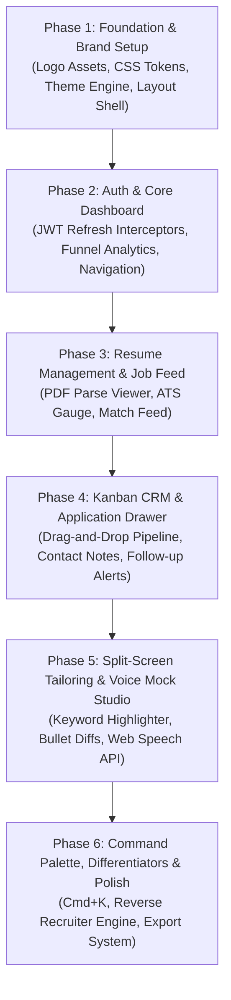

# JobWise — Frontend Architecture & Implementation Plan

> **Version:** 1.0.0  
> **Status:** Ready for Review & Execution  
> **Target Framework:** React 19 + TypeScript + Vite  
> **Brand Identity:** Official JobWise Emblem ("Your AI Career Companion")

---

## 1. Brand Identity & Logo Asset Integration

The official JobWise emblem features a dark navy academic graduation cap, an ascending blue career trajectory arrow, an executive briefcase with golden milestone bars, and the brand tagline *"YOUR AI CAREER COMPANION"*.

### Asset Pipeline
- **Source Artifact:** `C:\Users\devsh\.gemini\antigravity-ide\brain\90f40cf5-c361-4690-86cf-d4c304c59934\.user_uploaded\media_1793630213095.jpg`
- **Destination Target:**
  - `frontend/public/jobwise-logo.png` (High-res source)
  - `frontend/public/favicon.ico` / `favicon.svg` (Browser tab icon)
  - `frontend/src/assets/logo.png` (Bundled component asset)

### Surface Implementations
| Location | Variant | Behavior |
| :--- | :--- | :--- |
| **Sidebar Navigation** | Full Logo + Tagline (expanded); Icon Glyph (collapsed) | Smooth CSS transition between expanded/collapsed states |
| **Auth Screen Header** | Full Logo (Center 180px width) | Hero brand presentation with soft glow backdrop |
| **Header Bar (Mobile)** | Horizontal Compact Mark | Fixed top navigation on screens < 768px |
| **Loading & Splash Screen** | Centered Emblem with Subtle Pulse Animation | Pulsing CSS keyframe glow during initial auth check |
| **Empty States / Watermark** | Monochromatic / Low-opacity Emblem | Visual polish on empty Kanban columns or zero-match states |
| **Exported PDF / Docs** | Header Accent Watermark | Professional branding on exported tailored resumes |

---

## 2. Core Tech Stack & Dependency Matrix

All packages are aligned with the project's **Version Safety Rule**:

| Layer | Library / Tool | Purpose |
| :--- | :--- | :--- |
| **Build & Runtime** | `vite` + `react` (v19) + `react-dom` | High-speed ESM bundling & modern React rendering |
| **Language** | `typescript` (strict mode) | Strict type contracts across APIs and UI components |
| **Routing** | `react-router-dom` (v7) | Protected route guards, layout routing, dynamic route parameters |
| **HTTP Client** | `axios` | Single-flight refresh token interceptor, in-memory token store |
| **Server State** | `@tanstack/react-query` (v5) | Cache management, optimistic UI updates, auto-refetching |
| **Kanban / Drag-and-Drop** | `@dnd-kit/core` + `@dnd-kit/sortable` | Accessible, touch-friendly, high-performance drag and drop |
| **Forms & Validation** | `react-hook-form` + `@hookform/resolvers` + `zod` | Performant unmanaged form state with schema validation |
| **Icons** | `lucide-react` | Clean, customizable modern icon set |
| **Rich Text Sanitizer** | `dompurify` + `@types/dompurify` | Client-side XSS protection on AI-generated cover letters |
| **Styling & Theming** | Vanilla CSS with Design Tokens | Maximum performance, zero framework overhead, dynamic CSS variables |

---

## 3. Theme Engine & Deep Visual Customization System

### 3.1 Two-Tier Token Architecture (`src/styles/tokens.css`)

```css
:root {
  /* Surface & Base Mode (Light) */
  --color-mode: 'light';
  --bg-app: #f8fafc;
  --bg-surface: #ffffff;
  --bg-surface-hover: #f1f5f9;
  --bg-surface-card: #ffffff;
  --border-subtle: #e2e8f0;
  --border-strong: #cbd5e1;
  --text-main: #0f172a;
  --text-muted: #64748b;
  --text-subtle: #94a3b8;
  --shadow-sm: 0 1px 2px 0 rgba(0, 0, 0, 0.05);
  --shadow-md: 0 4px 6px -1px rgba(0, 0, 0, 0.1), 0 2px 4px -2px rgba(0, 0, 0, 0.1);
  --shadow-lg: 0 10px 15px -3px rgba(0, 0, 0, 0.1), 0 4px 6px -4px rgba(0, 0, 0, 0.1);

  /* Dynamic Accent Tokens (Default: Electric Indigo) */
  --primary: #6366f1;
  --primary-hover: #4f46e5;
  --primary-light: rgba(99, 102, 241, 0.12);
  --primary-glow: rgba(99, 102, 241, 0.28);
  --primary-fg: #ffffff;
  --radius-sm: 6px;
  --radius-md: 10px;
  --radius-lg: 16px;
  --radius-full: 9999px;
  --transition-fast: 150ms cubic-bezier(0.4, 0, 0.2, 1);
  --transition-normal: 250ms cubic-bezier(0.4, 0, 0.2, 1);
}

[data-theme="dark"] {
  --color-mode: 'dark';
  --bg-app: #080d1a;
  --bg-surface: #0f172a;
  --bg-surface-hover: #1e293b;
  --bg-surface-card: #131d31;
  --border-subtle: #1e293b;
  --border-strong: #334155;
  --text-main: #f8fafc;
  --text-muted: #94a3b8;
  --text-subtle: #64748b;
  --shadow-sm: 0 1px 2px 0 rgba(0, 0, 0, 0.5);
  --shadow-md: 0 4px 6px -1px rgba(0, 0, 0, 0.4);
  --shadow-lg: 0 10px 15px -3px rgba(0, 0, 0, 0.5);
}
```

### 3.2 Designer Presets & Custom Hex Engine
1. **⚡ Electric Violet** (`#6366f1` / `#7c3aed`) — Modern AI look.
2. **🌊 Oceanic Cyan** (`#06b6d4` / `#0284c7`) — Deep corporate and tech.
3. **🍃 Emerald Mint** (`#10b981` / `#059669`) — Growth and finance.
4. **🌅 Sunset Amber** (`#f59e0b` / `#ea580c`) — Creative and energetic.
5. **🌸 Rose Neon** (`#f43f5e` / `#e11d48`) — Bold and vibrant.
6. **🪨 Monochrome Titanium** (`#71717a` / `#27272a`) — Minimalist executive.
7. **🎨 Custom Hex Picker**: Any user-chosen color generates dynamic `--primary-hover` (15% darker), `--primary-light` (12% alpha), and `--primary-glow` (30% alpha).

### 3.3 Zero-FOUC Guarantee
Inline `<script>` in `index.html` executes synchronously before HTML body parsing:
```html
<script>
  (function() {
    const savedTheme = localStorage.getItem('jobwise_theme') || 'system';
    const prefersDark = window.matchMedia('(prefers-color-scheme: dark)').matches;
    const mode = savedTheme === 'system' ? (prefersDark ? 'dark' : 'light') : savedTheme;
    document.documentElement.setAttribute('data-theme', mode);
    const savedColor = localStorage.getItem('jobwise_accent_color');
    if (savedColor) {
      document.documentElement.style.setProperty('--primary', savedColor);
    }
  })();
</script>
```

---

## 4. Frontend Directory Structure

```
frontend/
├── public/
│   ├── jobwise-logo.png
│   ├── favicon.ico
│   └── favicon.svg
├── src/
│   ├── assets/
│   │   └── logo.png
│   ├── styles/
│   │   ├── tokens.css             # CSS variable design tokens
│   │   ├── globals.css            # Base reset, typography, utilities, keyframes
│   │   ├── components.css         # Reusable atomic styles (cards, buttons, inputs)
│   │   └── animations.css         # Shimmers, drawer slides, wave pulses
│   ├── lib/
│   │   ├── api/
│   │   │   ├── client.ts          # Axios client + refresh interceptor
│   │   │   └── refreshClient.ts   # Isolated client for refresh rotation
│   │   ├── theme/
│   │   │   ├── ThemeProvider.tsx  # Theme context, preset manager, hex injector
│   │   │   └── colorUtils.ts      # Contrast calculator, hex-to-rgb, hover shade math
│   │   ├── utils/
│   │   │   ├── date.ts            # Relative time formatters ("3 days ago")
│   │   │   └── exportPdf.ts       # Clean ATS resume and cover letter printer
│   ├── auth/
│   │   ├── tokenStore.ts          # In-memory access token storage
│   │   ├── AuthProvider.tsx       # Auth context, user profile, initial refresh check
│   │   └── RequireAuth.tsx        # Route authorization guard
│   ├── components/
│   │   ├── layout/
│   │   │   ├── AppLayout.tsx      # Main authenticated app frame
│   │   │   ├── Sidebar.tsx        # Collapsible brand sidebar with logo & badges
│   │   │   ├── Header.tsx         # Top bar with Cmd+K trigger, token budget, profile
│   │   │   ├── MobileNav.tsx      # Bottom navigation for small screens
│   │   │   ├── CommandPalette.tsx # Global Cmd+K quick launcher modal
│   │   │   └── CopilotDock.tsx    # Persistent contextual career assistant drawer
│   │   ├── ui/
│   │   │   ├── Button.tsx         # Primary, secondary, outline, danger, ghost
│   │   │   ├── Card.tsx           # Standard, interactive, glow variants
│   │   │   ├── Badge.tsx          # Status badges (Applied, Saved, Interviewing)
│   │   │   ├── Modal.tsx          # Accessible overlay dialog
│   │   │   ├── Drawer.tsx         # Slide-over panel with backdrop
│   │   │   ├── Tooltip.tsx        # Lightweight hover helper
│   │   │   ├── Spinner.tsx        # Branded loading indicator
│   │   │   └── Toast.tsx          # Action notifications with undo support
│   ├── features/
│   │   ├── auth/
│   │   │   ├── LoginPage.tsx
│   │   │   ├── RegisterPage.tsx
│   │   │   └── ForgotPasswordPage.tsx
│   │   ├── dashboard/
│   │   │   ├── DashboardPage.tsx
│   │   │   ├── FunnelChart.tsx           # Pipeline conversion visualizer
│   │   │   ├── VelocityTracker.tsx       # Weekly target gauge
│   │   │   └── QuickActionGrid.tsx
│   │   ├── resume/
│   │   │   ├── ResumePage.tsx
│   │   │   ├── UploadDropzone.tsx        # PDF/DOCX drag-drop with progress
│   │   │   ├── AtsScoreGauge.tsx         # Circular ATS score meter
│   │   │   └── StructuredResumeView.tsx  # Editable experience/skills cards
│   │   ├── jobs/
│   │   │   ├── JobFeedPage.tsx
│   │   │   ├── JobCard.tsx               # Match score, tags, rationale preview
│   │   │   ├── JobDetailModal.tsx        # Full job description & company intel
│   │   │   └── FilterBar.tsx             # Role, location, remote, comp filters
│   │   ├── tailoring/
│   │   │   ├── SplitScreenStudio.tsx     # Left: Job keywords; Right: Live bullets
│   │   │   ├── KeywordHighlighter.tsx    # Green matched, amber missing keywords
│   │   │   ├── BulletDiffCard.tsx        # Side-by-side diff with Accept/Reject
│   │   │   └── CoverLetterEditor.tsx     # Rich text editor with copy/export
│   │   ├── applications/
│   │   │   ├── KanbanBoard.tsx           # Drag-drop pipeline (@dnd-kit/core)
│   │   │   ├── KanbanColumn.tsx          # Saved, Applied, Interviewing, Offer, etc.
│   │   │   ├── ApplicationCard.tsx       # Company badge, days in stage, alert flag
│   │   │   ├── ApplicationCrmDrawer.tsx  # Timeline, contacts, notes, salary log
│   │   │   └── GhostingAlertBanner.tsx   # Overdue follow-up detector
│   │   ├── interviewPrep/
│   │   │   ├── InterviewStudioPage.tsx
│   │   │   ├── VoiceRecordingStudio.tsx  # Web Speech API + audio waveform
│   │   │   ├── TimedAnswerMode.tsx       # 2-minute countdown timer
│   │   │   └── StarRubricRadar.tsx       # Multi-metric radar chart
│   │   ├── skillGaps/
│   │   │   ├── SkillGapsPage.tsx
│   │   │   ├── TargetRoleSelector.tsx
│   │   │   └── InteractiveRoadmap.tsx    # "Mark as Acquired" progress checklist
│   │   ├── freelance/
│   │   │   ├── FreelanceGigsPage.tsx
│   │   │   └── PitchGeneratorModal.tsx
│   │   └── settings/
│   │       ├── SettingsPage.tsx
│   │       ├── AppearanceSection.tsx     # Mode toggle, 6 presets, hex picker
│   │       ├── TargetRolesSection.tsx    # Roles, location, salary preferences
│   │       └── AiBudgetMeter.tsx         # Monthly token usage visualizer
│   ├── App.tsx                           # Route declarations
│   └── main.tsx                          # App root mounting
```

---

## 5. Screen-by-Screen User Journey & Key Interfaces

### 1. Brand Onboarding & Auth (`/login`, `/register`)
- **Visuals:** Left side showcases the JobWise emblem with glassmorphic cards previewing features; right side renders clean, high-contrast authentication forms.
- **Features:** Email/password login, Google OAuth button, quick demo credentials filler, error alerts.

### 2. Executive Dashboard (`/dashboard`)
- **Key Cards:**
  - **Funnel Conversion Bar:** Visual metrics from Saved (35) → Applied (20) → Interviewing (5) → Offers (2).
  - **Weekly Velocity Ring:** Radial gauge tracking weekly applications completed vs. target.
  - **Follow-up Action Center:** Highlighted cards flagged by the Ghosting Detector with 1-click email draft triggers.
  - **Top 3 Recommended Matches:** AI-curated jobs with match scores ≥ 85%.

### 3. Smart Job Match Feed (`/jobs`)
- **Inline Match Explanation:** Every card immediately displays *"Why this matches: Strong React & TypeScript alignment (+88%); Missing: Docker (-12%)"*.
- **Actions:** 1-click "Save", "Dismiss", or "Tailor Application" (which launches the Split-Screen Studio).

### 4. Interactive Split-Screen Tailoring Studio (`/tailor/:jobId`)
- **Left Panel (Job Spec):** Parsed job description with active keyword chips categorized into Hard Skills, Tools, and Soft Skills.
- **Right Panel (Tailored Workspace):**
  - AI Bullet Editor: Each resume bullet has an **"Enhance for this Job"** toggle showing a visual diff (`+ added quantifiable metric`, `- removed passive phrasing`).
  - Cover Letter Tab: Tailored 3-paragraph pitch incorporating the company's strategic angle.
  - 1-Click Export: Clean ATS-compatible PDF and plain-text clipboard copy.

### 5. Application CRM & Kanban Board (`/applications`)
- **Columns:** `Saved` → `Applied` → `Interviewing` → `Offer` → `Rejected / Withdrawn`.
- **Drag-and-Drop:** Smooth physics via `@dnd-kit/core` with optimistic UI transitions.
- **Detail Slide-over Drawer:** Clicking any card opens a deep-dive drawer:
  - Recruiter Contact Card (Name, LinkedIn URL, email).
  - Timeline Milestones (Interview rounds with date stamps).
  - Offer Evaluator: If in "Offer" stage, compares Base, Bonus, and Equity with counter-offer generation.

### 6. Voice & Timed Mock Interview Studio (`/interview-prep/:id`)
- **Question Prompts:** Generated dynamically from the target job description.
- **Interactive Audio Mode:** Click microphone to activate browser Web Speech API with real-time speech transcription.
- **Countdown Pressure Mode:** Optional 2-minute timer with visual urgency rings.
- **STAR Radar Score:** Immediate feedback on Situation, Task, Action, and Result structure with coaching suggestions.

### 7. Settings & Visual Customization (`/settings`)
- **Mode Toggle:** Light, Dark, System Default.
- **Theme Preset Buttons:** 6 rounded color swatches with active selection indicators.
- **Custom Color Picker:** Interactive hex input updating all app accents in real time.
- **Live Preview Card:** Dynamic button and badge reflecting the chosen theme instantaneously.

---

## 6. Phased Implementation Roadmap



### Phase Details

#### Step 1: Foundation & Brand Setup
- Initialize clean Vite + React 19 + TypeScript template in `frontend/`.
- Copy official JobWise logo asset to `frontend/public/jobwise-logo.png` and `src/assets/logo.png`.
- Establish `src/styles/tokens.css` (surface colors, dynamic accents, typography, spacing).
- Implement `ThemeProvider` with zero-FOUC inline script in `index.html`.

#### Step 2: Auth Client & Layout Shell
- Implement Axios client with in-memory `tokenStore` and single-flight refresh interceptor.
- Create `AppLayout` with collapsible `Sidebar` (incorporating full logo and collapsed icon), `Header` with AI budget meter, and `RequireAuth` guard.
- Build `LoginPage` and `RegisterPage` with hero branding.

#### Step 3: Resume Parser & Match Feed
- Implement `UploadDropzone` with PDF/DOCX preview and ATS score radial gauge.
- Build `JobFeedPage` with match score badges and inline match explanations.

#### Step 4: Kanban CRM Pipeline
- Build Kanban board with `@dnd-kit/core` supporting drag-and-drop column transitions.
- Build `ApplicationCrmDrawer` for recruiter contacts, interview timelines, and follow-up alerts.

#### Step 5: Split-Screen Tailoring & Voice Mock Studio
- Build `SplitScreenStudio` with side-by-side keyword matching and visual bullet diffs.
- Implement `VoiceRecordingStudio` utilizing Web Speech API and 2-minute timed pressure mode.
- Render multi-dimensional STAR scoring radar chart.

#### Step 6: Polish & Unique Differentiators
- Implement Global Command Palette (`Cmd+K` / `Ctrl+K`).
- Add "Reverse Recruiter AI" strategic company pitch and 300-char LinkedIn outreach generator.
- Integrate 1-click ATS PDF export and verify complete theme responsiveness.

---

## 7. Approval & Next Steps

This plan establishes a complete, robust frontend architecture tailored specifically to JobWise's mission and brand identity. Upon your confirmation, execution begins immediately starting with **Step 1: Foundation, Logo Assets & Theme Engine Setup**.
